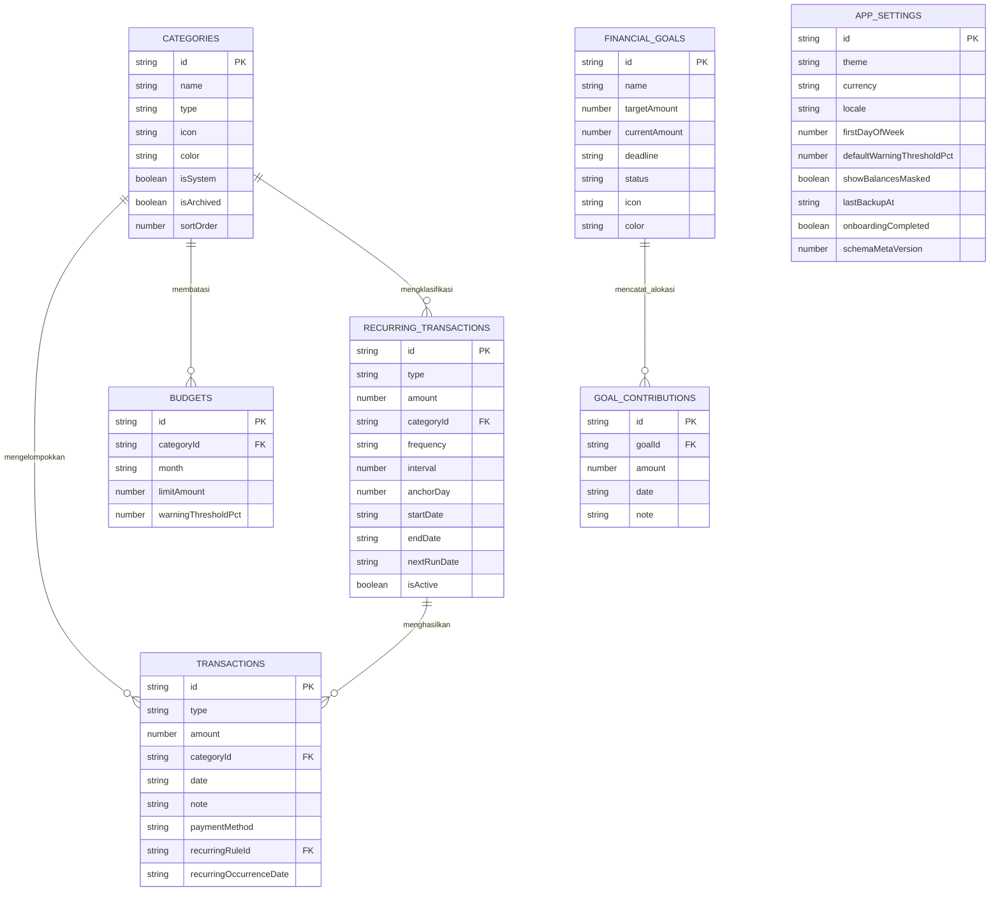

# Database Schema — Finora (`FinoraDB`)

**Versi Dokumen**: 1.0.0  
**Teknologi**: IndexedDB melalui **Dexie.js**  
**Nama Basis Data Kanonik**: `FinoraDB`  
**Versi Skema Awal**: `1`  
**Dokumen Terkait**: [DATA_DICTIONARY.md](./DATA_DICTIONARY.md) | [BUSINESS_RULES.md](../02-requirements/BUSINESS_RULES.md) | [ADR-002](./ADR/ADR-002-indexeddb-dexie.md)

---

## 1. Diagram Entitas & Relasi (*Entity-Relationship Diagram*)

> Catatan: IndexedDB adalah basis data objek non-relasional tanpa *foreign key constraint* bawaan mesin DB. Relasi di bawah merupakan **relasi logis** yang dijaga secara ketat oleh *Client-Side Service Layer* (`DATA-004`).



---

## 2. Definisi Skema Dexie.js (Versi 1)

Berikut definisi indeks kanonik Dexie.js untuk `FinoraDB` v1:

```ts
import Dexie, { type Table } from 'dexie';

export class FinoraDatabase extends Dexie {
  transactions!: Table<TransactionRecord, string>;
  categories!: Table<CategoryRecord, string>;
  budgets!: Table<BudgetRecord, string>;
  financialGoals!: Table<FinancialGoalRecord, string>;
  goalContributions!: Table<GoalContributionRecord, string>;
  recurringTransactions!: Table<RecurringTransactionRecord, string>;
  appSettings!: Table<AppSettingsRecord, string>;

  constructor() {
    super('FinoraDB');

    this.version(1).stores({
      transactions:
        'id, type, categoryId, date, [type+date], [categoryId+date], recurringRuleId, [recurringRuleId+recurringOccurrenceDate], createdAt',
      categories:
        'id, type, name, isSystem, isArchived, sortOrder, [type+isArchived]',
      budgets:
        'id, categoryId, month, &[categoryId+month]',
      financialGoals:
        'id, status, deadline, createdAt',
      goalContributions:
        'id, goalId, date, [goalId+date], createdAt',
      recurringTransactions:
        'id, type, categoryId, isActive, nextRunDate, [isActive+nextRunDate]',
      appSettings:
        'id',
    });
  }
}
```

> **Catatan Teknis IndexedDB & Boolean Index**: Di beberapa browser/versi IndexedDB, nilai boolean (`true`/`false`) pada compound index bisa sensitif jika tidak diseragamkan, namun Dexie 4 mendukung query `.where('[type+isArchived]')` atau fallback filter di memori pada tabel kecil seperti `categories` (umumnya `< 100` baris). Indeks `[type+isArchived]` disediakan untuk konsistensi; jika implementor menemukan isu lintas browser saat pengujian Safari/IndexedDB dengan tipe boolean pada index key, penyaringan `isArchived` dapat dilakukan setelah `.where('type').equals(type)` dan dicatat di migration/test notes.

---

## 3. Rincian Tabel, Primary Key, dan Indeks

### 3.1 `transactions`
- **Primary Key**: `id` (UUID v4 string).
- **Indeks**:
  - `type` — filter cepat `income` / `expense`.
  - `categoryId` — pencarian referensi saat edit/hapus kategori.
  - `date` — kueri rentang tanggal (`between('2026-11-01', '2026-11-30', true, true)`).
  - `[type+date]` — agregasi cepat `TotalIncome(P)` dan `TotalExpense(P)` per rentang tanggal.
  - `[categoryId+date]` — agregasi cepat `BudgetSpent(c, m)` untuk bulan tertentu.
  - `recurringRuleId` — melacak transaksi hasil aturan berulang tertentu.
  - `[recurringRuleId+recurringOccurrenceDate]` — pengecekan idempotensi `RULE-015` (catatan: hanya record non-null atau dicek eksplisit sebelum insert karena transaksi manual memiliki `null` pada kedua kolom ini; oleh karena itu **jangan gunakan `&` unique constraint** pada `[recurringRuleId+recurringOccurrenceDate]` agar banyak transaksi manual dengan `(null, null)` tidak saling menabrak!).
  - `createdAt` — pengurutan deterministik sekunder pada tanggal yang sama.

### 3.2 `categories`
- **Primary Key**: `id` (UUID v4 untuk kustom; ID deterministik `cat-sys-*` untuk 13 kategori sistem agar konsisten di backup/restore).
- **Indeks**: `type`, `name`, `isSystem`, `isArchived`, `sortOrder`, `[type+isArchived]`.

### 3.3 `budgets`
- **Primary Key**: `id` (UUID v4).
- **Indeks**:
  - `categoryId` — pengecekan referensi kategori.
  - `month` — memuat seluruh anggaran bulan `YYYY-MM` dalam satu kueri.
  - `&[categoryId+month]` — **unique compound index** yang menjamin maksimal 1 anggaran per kategori per bulan (`RULE-008`).

### 3.4 `financialGoals`
- **Primary Key**: `id` (UUID v4).
- **Indeks**: `status`, `deadline`, `createdAt`.

### 3.5 `goalContributions`
- **Primary Key**: `id` (UUID v4).
- **Indeks**: `goalId`, `date`, `[goalId+date]`, `createdAt`.

### 3.6 `recurringTransactions`
- **Primary Key**: `id` (UUID v4).
- **Indeks**: `type`, `categoryId`, `isActive`, `nextRunDate`, `[isActive+nextRunDate]`.

### 3.7 `appSettings`
- **Primary Key**: `id` (singleton bernilai tetap `'default'`).

---

## 4. Aturan Integritas Data (*Data Integrity Rules*)

1. **Invarian Tipe Kategori**: `transaction.type === category.type`, `recurringTransaction.type === category.type`, dan `budget` hanya merujuk ke kategori bertipe `'expense'`.
2. **Invarian Non-Negatif Target**: `financialGoals.currentAmount >= 0` dan harus selalu sama dengan jumlah seluruh `goalContributions.amount` untuk `goalId` terkait (`RULE-018`).
3. **Pencegahan Orphan Records**:
   - Penghapusan `financialGoals` wajib menghapus seluruh `goalContributions` dengan `goalId` sama dalam satu transaksi atomik.
   - Penghapusan `categories` terpakai dilarang tanpa *reassignment* atomik seluruh tabel perujuk (`RULE-020`).
4. **Pembatasan Null pada Indeks Unik**: Hanya `&[categoryId+month]` pada `budgets` yang memakai indeks unik DB karena `categoryId` dan `month` selalu string non-null. Idempotensi transaksi berulang `[recurringRuleId+recurringOccurrenceDate]` dijaga di level transaksi service sebelum penyisipan.

---

## 5. Strategi Versioning & Migrasi Skema (`DATA-007`)

1. **Jangan Memodifikasi Definisi Versi yang Sudah Dirilis**: Setelah `version(1)` dirilis ke produksi, perubahan kolom terindeks atau struktur data di masa depan **wajib** menambahkan blok `this.version(2).stores({...}).upgrade(tx => {...})` baru.
2. **Pemeliharaan Indeks Lama**: Pada Dexie.js, setiap blok `.stores()` pada versi baru harus menyertakan seluruh tabel dan indeks yang masih dipakai, atau `null` untuk tabel yang dihapus.
3. **Keselarasan dengan Backup JSON**: `appSettings.schemaMetaVersion` dan `backupEnvelope.dbSchemaVersion` selalu mengikuti nomor versi skema database aktif (`1` pada MVP). Jika aplikasi v2 kelak mengimpor backup `dbSchemaVersion: 1`, `backupService` menjalankan fungsi migrator murni `migrateBackupPayload(v1 -> v2)` sebelum menulis ke `FinoraDB` v2.
4. **Pengujian Upgrade Wajib**: Sebelum rilis versi skema baru, siapkan fixture JSON/IndexedDB versi lama di test suite untuk memastikan tidak ada data yang hilang atau gagal upgrade.
