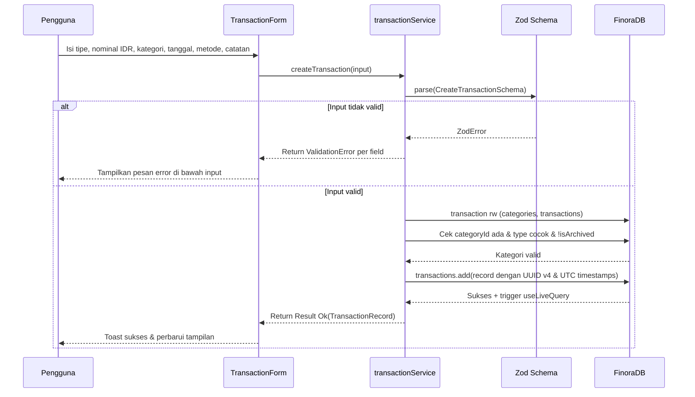
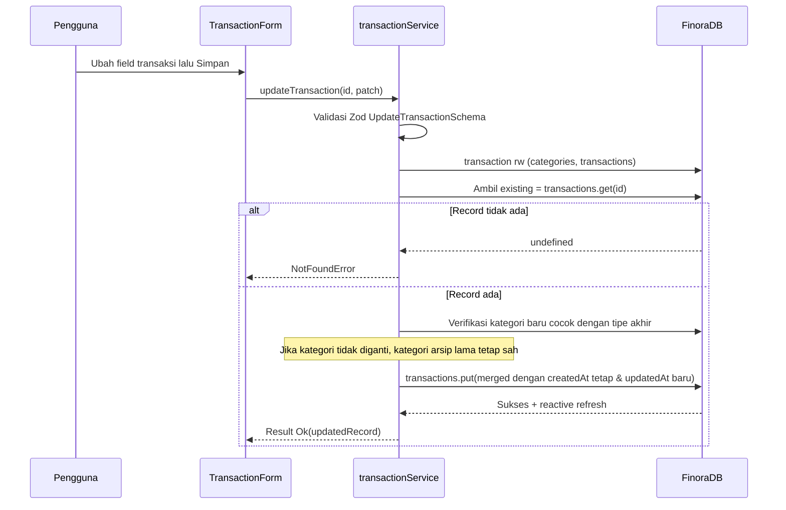
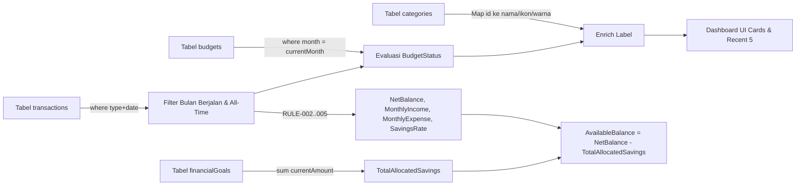
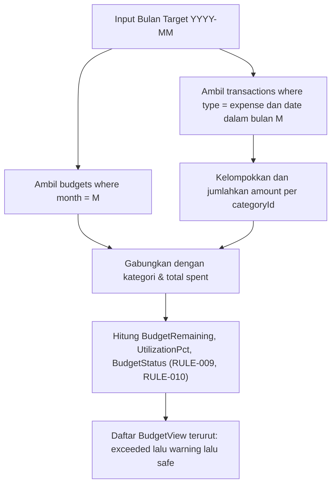
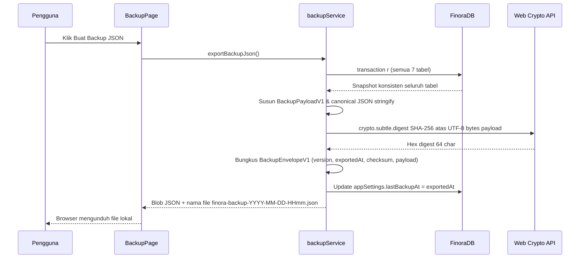
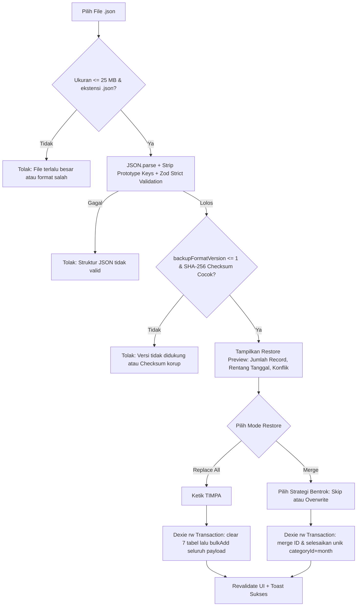

# Data Flow Specification — Finora

**Versi Dokumen**: 1.0.0  
**Tujuan**: Mendokumentasikan sembilan alur data utama di dalam runtime klien Finora, lengkap dengan diagram alur dan kontrak validasi/transaksi.  
**Dokumen Terkait**: [SYSTEM_ARCHITECTURE.md](./SYSTEM_ARCHITECTURE.md) | [API_DESIGN.md](./API_DESIGN.md) | [BUSINESS_RULES.md](../02-requirements/BUSINESS_RULES.md)

---

## 1. Pembuatan Transaksi (*Transaction Creation*)

---

## 2. Penyuntingan Transaksi (*Transaction Editing*)

---

## 3. Penghapusan Transaksi (*Transaction Deletion*)

1. Pengguna menekan tombol **Hapus** pada item transaksi.
2. UI membuka `ConfirmDialog` yang menampilkan nominal, nama kategori, dan tanggal transaksi.
3. Setelah pengguna menekan **Hapus Permanen**, UI memanggil `transactionService.deleteTransaction(id)`.
4. Service memeriksa keberadaan record (mengembalikan `NotFoundError` jika sudah tidak ada) dan mengeksekusi `db.transactions.delete(id)`.
5. `useLiveQuery` secara reaktif memperbarui halaman Transaksi, ringkasan Dashboard, dan realisasi Anggaran bulan terkait.

---

## 4. Agregasi Dashboard (*Dashboard Aggregation*)

- Seluruh perhitungan agregasi dieksekusi di `dashboardService.getDashboardSummary(currentMonth)` dengan memanggil fungsi murni di `src/domain/calculators.ts`.
- Total transaksi yang dibaca dibatasi dengan indeks `date` untuk periode bulan berjalan dan 6 bulan terakhir (untuk mini chart), sementara `NetBalance` menggunakan indeks `type` atau penjumlahan teroptimasi (`NFR-001`).

---

## 5. Perhitungan Anggaran (*Budget Calculation*)

- Jika terdapat pengeluaran pada kategori yang **tidak memiliki** anggaran di bulan `M`, pengeluaran tersebut tetap dihitung pada total pengeluaran Dashboard/Analytics, tetapi tidak dimunculkan sebagai pelanggaran anggaran di `/budgets` (tersedia daftar kategori belum dianggarkan sebagai saran opsional).

---

## 6. Wawasan Keuangan (*Financial Insights*)

1. `analyticsService.getAnalyticsOverview(range)` membaca transaksi dalam rentang periode terpilih dan periode pembanding sebelumnya (misalnya bulan lalu).
2. `insightsEngine.generateInsights(currentData, previousData, budgets, goals)` mengevaluasi aturan deterministik lokal berikut secara berurutan:
   - **Perubahan Pengeluaran MoM**: membandingkan `TotalExpense(M)` vs `TotalExpense(M-1)` (menghitung delta persen jika `M-1 > 0`).
   - **Kategori Pengeluaran Terbesar**: kategori dengan proporsi tertinggi terhadap `TotalExpense(M)`.
   - **Kesehatan Rasio Tabungan**: klasifikasi berbasis `SavingsRate(M)` (`>= 20%` sehat, `0..19.9%` tipis, `< 0%` defisit, `null` belum ada pemasukan).
   - **Peringatan Anggaran Kritis**: jumlah kategori berstatus `'exceeded'` dan `'warning'` bulan berjalan.
   - **Progres Target Terdekat**: target aktif dengan persentase tertinggi atau yang memiliki tenggat terdekat.
3. Seluruh teks wawasan dirakit di klien dari templat terstruktur Bahasa Indonesia tanpa memanggil API LLM eksternal.

---

## 7. Ekspor Backup JSON (*Backup Flow*)

---

## 8. Pemulihan Backup JSON (*Restore Flow*)

---

## 9. Ekspor Laporan CSV (*CSV Export Flow*)

1. Pengguna memilih rentang tanggal dan filter pada halaman `/reports`, lalu menekan **Ekspor CSV**.
2. `exportService.buildTransactionsCsv(transactions, categoryMap)` memetakan setiap record menjadi baris dengan urutan kolom tetap:
   `Tanggal,Tipe,Kategori,Metode Pembayaran,Catatan,Nominal (IDR)`.
3. Setiap nilai string (`Kategori`, `Catatan`) melewati `sanitizeCsvCell(value)`:
   - Jika karakter pertama adalah `=`, `+`, `-`, `@`, `\t`, atau `\r`, tambahkan prefiks `'` (`SEC-006`).
   - Bungkus dengan tanda kutip ganda `"` dan gandakan kutip ganda di dalamnya (`""`) sesuai RFC 4180.
4. Gabungkan baris dengan `\r\n`, awali dengan UTF-8 BOM (`\uFEFF`) agar Microsoft Excel di Windows Indonesia membaca karakter dan pemisah kolom dengan benar.
5. Buat `Blob` bertipe `text/csv;charset=utf-8` dan picu unduhan lokal `finora-laporan-YYYY-MM-DD.csv` tanpa komunikasi jaringan.
