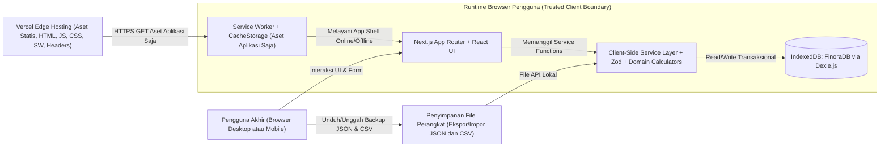
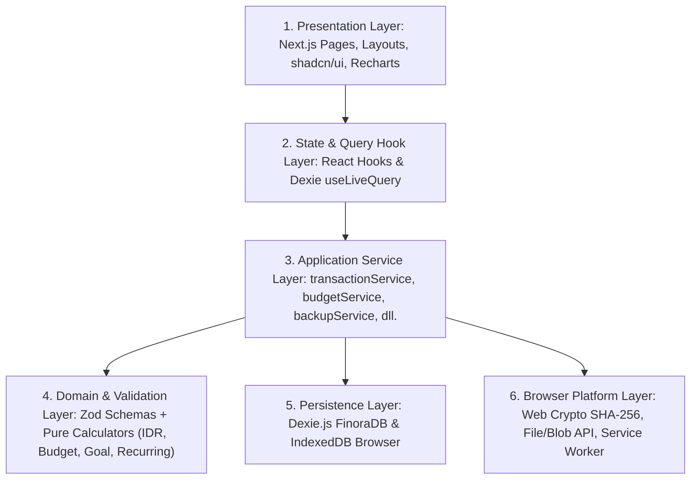
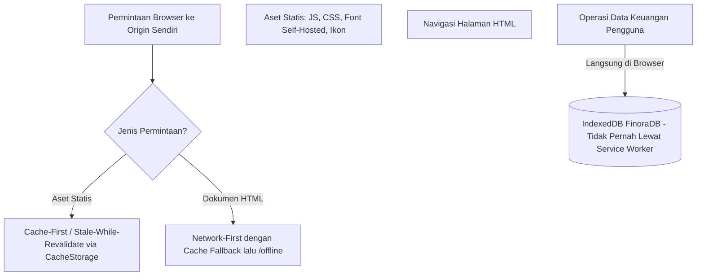
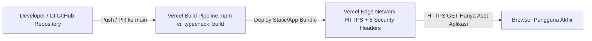

# System Architecture — Finora

**Versi Dokumen**: 1.0.0  
**Status**: Baseline Disetujui  
**Dokumen Terkait**: [DATABASE_SCHEMA.md](./DATABASE_SCHEMA.md) | [DATA_FLOW.md](./DATA_FLOW.md) | [API_DESIGN.md](./API_DESIGN.md) | [PWA_STRATEGY.md](../06-pwa/PWA_STRATEGY.md) | [SECURITY.md](../05-security/SECURITY.md)

---

## 1. Gambaran Umum Arsitektur (*Architecture Overview*)

Finora mengadopsi arsitektur **Client-Side Local-First Progressive Web Application (PWA)** yang di-hosting secara statis/edge di **Vercel**. Tidak terdapat server aplikasi bisnis, API penyimpanan jarak jauh, maupun basis data cloud. Seluruh siklus hidup data keuangan—mulai dari validasi input, kalkulasi akuntansi pribadi, persistensi ke **IndexedDB (`FinoraDB`)** via **Dexie.js**, visualisasi **Recharts**, hingga ekspor laporan CSV dan backup JSON—berjalan 100% di dalam runtime browser perangkat pengguna.

---

## 2. Prinsip Arsitektur

1. **Zero-Backend Financial Processing**: Server Vercel hanya mengirimkan bundel halaman, aset JavaScript/CSS, font self-hosted, manifest PWA, dan Service Worker melalui HTTPS.
2. **Strict Layer Separation**: UI React tidak memanggil Dexie.js secara sembarangan untuk mutasi; seluruh mutasi dan kueri kompleks melewati *Client-Side Service Layer* (`src/services/*`) yang dilindungi validasi **Zod** dan kalkulator domain murni (`src/domain/*`).
3. **Deterministic Pure Domain Logic**: Rumus keuangan (`BUSINESS_RULES.md`) ditulis sebagai fungsi murni (*pure functions*) tanpa efek samping I/O sehingga dapat diuji 100% secara terisolasi.
4. **Atomic Local Persistence**: Operasi lintas-tabel (seperti kontribusi target, *reassignment* kategori, materialisasi berulang, dan restore backup) wajib dibungkus `db.transaction('rw', ...)`.
5. **Storage & Cache Isolation**: Service Worker `CacheStorage` hanya menyimpan aset aplikasi statis, sedangkan data finansial pengguna disimpan eksklusif di IndexedDB.

---

## 3. Batas Sistem & Konteks (*System Context & Boundaries*)

### Penegasan Batas (*Boundaries*)
- **Batas Jaringan**: Satu-satunya komunikasi jaringan adalah `GET` aset statis ke origin `'self'` (Vercel). Tidak ada `POST`/`PUT`/`DELETE` ke endpoint jarak jauh dan tidak ada koneksi ke layanan analitik/iklan pihak ketiga.
- **Batas Persistensi**: `FinoraDB` terikat pada *browser origin* (misal `https://finora.app`). Penghapusan data situs browser menghapus IndexedDB di origin tersebut.

---

## 4. Tanggung Jawab Komponen Lapisan Aplikasi (*Layered Component Architecture*)

| Lapisan | Lokasi Usulan | Tanggung Jawab Utama | Larangan |
|---|---|---|---|
| **Presentation** | `src/app/`, `src/components/` | Rendering komponen, form state, aksesibilitas, loading/empty/error UI, pemformatan tampilan `tabular-nums`. | Dilarang menulis rumus bisnis kompleks atau memanggil `db.table.add()` langsung dari komponen UI. |
| **Hooks / Reactive Binding** | `src/hooks/` | Mengikat data reaktif `useLiveQuery` ke komponen UI, mengelola toast & state lokal halaman. | Dilarang melakukan mutasi database langsung tanpa service layer. |
| **Application Service** | `src/services/` | Orkestrasi validasi Zod, pengecekan integritas referensial, transaksi atomik Dexie, ekspor/impor file, materialisasi berulang. | Dilarang melakukan `fetch()` ke endpoint data eksternal. |
| **Domain & Validation** | `src/domain/`, `src/schemas/` | Definisi skema `.strict()` Zod, rumus saldo/budget/goal/insight, logika tanggal lokal & *clamping*. | Dilarang bergantung pada `window`, `document`, atau Dexie I/O agar 100% pure & testable. |
| **Persistence** | `src/db/` | Definisi kelas `FinoraDexie`, definisi tabel & indeks versi, skrip seeding awal, migrasi versi skema. | Dilarang menyimpan logika UI atau transformasi CSV/PDF. |

---

## 5. Siklus Hidup Aplikasi (*Application Lifecycle*)

1. **App Shell Load**: Browser memuat HTML/JS/CSS dari Service Worker cache (kunjungan ulang) atau Vercel HTTPS (kunjungan awal).
2. **Client Hydration & Theme Resolution**: Skrip tema sinkron ringan atau provider tema menerapkan tema (`dark` default / `light`) untuk meminimalkan *flash of unstyled theme*.
3. **Database Bootstrap (`bootstrapService.initializeApp()`)**:
   - Membuka koneksi `FinoraDB` (jika ada upgrade versi skema, Dexie menjalankan blok `upgrade()`).
   - Mengecek `appSettings` (`id === 'default'`) dan tabel `categories`. Jika kosong, menyisipkan 13 kategori sistem dan `appSettings` default secara atomik (`UC-001`).
4. **Opportunistic Recurring Materialization**:
   - Mengevaluasi aturan `recurringTransactions` aktif di mana `nextRunDate <= today` secara idempoten (`RULE-014` – `RULE-016`).
5. **Storage Persistence & SW Registration**:
   - Memeriksa status izin persistensi opsional (`navigator.storage.persisted()`).
   - Mendaftarkan Service Worker dan memantau event `updatefound` untuk menampilkan banner pembaruan bila ada versi baru.
6. **Interactive Reactive Loop**:
   - Mutasi melalui service layer memperbarui IndexedDB → `useLiveQuery` otomatis memicu re-render komponen yang berlangganan pada tabel terkait.

---

## 6. Arsitektur Offline & PWA (*Offline Architecture*)

- Penjelasan lengkap strategi caching, isolasi cache, dan skenario offline tercantum di [PWA_STRATEGY.md](../06-pwa/PWA_STRATEGY.md) dan [OFFLINE_BEHAVIOR.md](../06-pwa/OFFLINE_BEHAVIOR.md).

---

## 7. Arsitektur Deployment (*Vercel Hosting Architecture*)

- **Vercel Scope**: Next.js dikonfigurasi tanpa database binding, tanpa Vercel KV/Postgres/Blob, dan tanpa server-side session. Aplikasi dikirimkan sebagai halaman statis/app-router client-rendered dengan seluruh halaman keuangan memuat data dari IndexedDB di dalam `useEffect` / `useLiveQuery` pada komponen klien (`'use client'`).
- **Security Headers**: Dikonfigurasi via `next.config.*` / `vercel.json` (atau `middleware.ts` apabila menggunakan nonce CSP dinamis) sesuai [SECURITY.md](../05-security/SECURITY.md).

---

## 8. Trade-Off Arsitektur

| Keputusan | Keuntungan | Keterbatasan / Konsekuensi |
|---|---|---|
| **Local-First Tanpa Backend** | Privasi mutlak, nol biaya database/server, latensi baca/tulis lokal sangat rendah, aman offline penuh. | Tidak ada sinkronisasi real-time antar-perangkat; pengguna bertanggung jawab menjaga backup JSON. |
| **Client-Rendered Data Views** | Menghindari *hydration mismatch* SSR antara server (tidak punya data user) dan browser (punya IndexedDB). | Halaman membutuhkan skeleton/loading state klien singkat (beberapa milidetik) saat membuka IndexedDB pertama kali. |
| **Pure Domain + Service Layer** | Mudah diuji dengan unit/integration test tanpa me-mount UI; menjamin angka konsisten lintas halaman. | Sedikit lebih banyak file boilerplate dibanding menulis query Dexie langsung di komponen. |
| **Single Currency (`IDR`) di MVP** | Menghilangkan kompleksitas kurs, pembulatan multi-presisi, dan UI konversi yang berpotensi membingungkan. | Pengguna yang mencatat banyak valuta asing harus menunggu ekstensi V3 atau mencatat dalam ekuivalen IDR. |

---

## Dokumen Terkait
- [DATABASE_SCHEMA.md](./DATABASE_SCHEMA.md) — Struktur lengkap 7 tabel `FinoraDB`, indeks, dan migrasi.
- [API_DESIGN.md](./API_DESIGN.md) — Kontrak *Client-Side Service Layer* (bukan REST API).
- [ADR-001](./ADR/ADR-001-local-first-architecture.md) s.d. [ADR-006](./ADR/ADR-006-json-backup-restore.md) — Catatan keputusan arsitektur.
