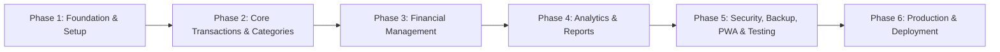

# Implementation Roadmap — Finora

**Versi Dokumen**: 1.0.0  
**Tujuan**: Menetapkan peta jalan eksekusi bertahap dari fondasi hingga rilis produksi Vercel.  
**Dokumen Terkait**: [BACKLOG.md](./BACKLOG.md) | [MILESTONES.md](./MILESTONES.md) | [AGENT_BRIEF.md](../07-development/AGENT_BRIEF.md)

---

## Ringkasan 6 Fase Eksekusi

---

## Phase 1: Foundation and Project Setup
**Fokus**: Fondasi teknis, desain sistem, basis data lokal, dan kerangka navigasi.
- Konfirmasi lokasi App Root (`OQ-01`) dan inisialisasi proyek Next.js App Router + TypeScript `strict: true`.
- Konfigurasi Tailwind CSS, shadcn/ui, `next/font/google` (`Plus Jakarta Sans` & `JetBrains Mono`), dan palet token Dark/Light dari [STYLING.md](../04-design/STYLING.md).
- Implementasi utilitas domain fondasi (`money.ts`, `dates.ts`, `constants.ts`) + Zod common schemas.
- Definisi `FinoraDB` v1 (7 tabel, indeks) dan `bootstrapService` (13 kategori sistem + `appSettings`).
- Pembangunan `AppShell`, `AppSidebar`, `MobileBottomNav`, `TopHeader`, `ThemeToggle`, `PrivacyMaskToggle`, dan komponen bersama (`MoneyText`, `CurrencyInput`, `EmptyState`, `ConfirmDialog`).

## Phase 2: Core Transaction Management
**Fokus**: Nilai guna inti hari pertama—mencatat, mengelola, mencari transaksi, kategori, dan Dashboard dasar.
- Implementasi `transactionService` (CRUD + query filter multi-kriteria + subtotal) dan `categoryService` (CRUD + arsip + reassignment atomik).
- Implementasi `dashboardService` (`NetBalance`, `AvailableBalance`, `MonthlyIncome/Expense`, `SavingsRate`, 5 transaksi terbaru).
- Pembangunan halaman Dashboard (`/`), Transactions (`/transactions`), Add/Edit Transaction (`/transactions/new`, `/transactions/[id]/edit`), dan Categories (`/categories`).
- Unit & integration tests (`fake-indexeddb`) untuk seluruh aturan transaksi dan kategori.

## Phase 3: Financial Management (Budgets, Goals, Recurring)
**Fokus**: Pengendalian anggaran, perencanaan tabungan tanpa *double counting*, dan otomatisasi lokal.
- Implementasi `budgetService` (`BudgetSpent`, `BudgetRemaining`, `BudgetStatus`, salin dari bulan lalu) + halaman `/budgets`.
- Implementasi `goalService` (target + kontribusi earmark `goalContributions` + estimasi `RequiredMonthlySaving` + invarian non-negatif) + halaman `/goals`.
- Implementasi `recurringService` (*end-of-month clamping*, idempotensi `[recurringRuleId+recurringOccurrenceDate]`, batas catch-up 366, integrasi ke `bootstrapService`) + halaman `/recurring`.
- Pengujian menyeluruh rumus `RULE-008` s.d. `RULE-018`.

## Phase 4: Analytics and Insights
**Fokus**: Wawasan visual perilaku keuangan dan ekspor laporan portabel.
- Implementasi `analyticsService` (agregasi deret waktu, distribusi kategori, perbandingan periode) dan `insightsEngine` (wawasan deterministik lokal).
- Pembangunan halaman Analytics (`/analytics`) dengan grafik Recharts responsif sesuai palet terkalibrasi Dark/Light.
- Implementasi `exportService` (CSV UTF-8 BOM + proteksi *CSV formula injection*) dan halaman Reports (`/reports`) beserta print stylesheet `@media print`.

## Phase 5: Security, Backup, PWA, and Testing
**Fokus**: Ketahanan data, portabilitas JSON, pengalaman offline PWA, dan penguatan keamanan penuh.
- Implementasi `settingsService` (preferensi, status penyimpanan browser, Factory Reset berkonfirmasi `"HAPUS"`) + halaman `/settings`.
- Implementasi `backupService` (ekspor envelope JSON v1 + SHA-256 checksum, gate validasi 5 tahap, Restore Preview, mode `Replace All` & `Merge` atomik) + halaman `/settings/backup`.
- Implementasi PWA: `manifest.ts`, ikon PWA, Service Worker (isolasi cache dari data finansial, controlled update banner), halaman `/offline`, dan `OfflineStatusBanner`.
- Konfigurasi 8 HTTP security headers & CSP produksi yang lolos audit; lengkapi seluruh test suite (`TC-001` – `TC-040`), benchmark 5.000 transaksi, dan uji aksesibilitas/responsivitas.

## Phase 6: Production and Deployment
**Fokus**: Website publik pemasaran, SEO, kesiapan rilis publik, dan verifikasi lingkungan Vercel.
- Pembangunan Website Publik (`(public)/`: `/`, `/features`, `/about`, `/privacy`) yang terisolasi dari IndexedDB beserta pemisahan workspace aplikasi ke `/app/*` ([LANDING_PAGE.md](../04-design/LANDING_PAGE.md), [PUBLIC_ROUTES.md](../04-design/PUBLIC_ROUTES.md)).
- Implementasi metadata SEO, Open Graph, `sitemap.ts`, `robots.ts`, favicon, dan `og-image.png` ([SEO.md](../09-deployment/SEO.md)).
- Konfigurasi proyek GitHub & Vercel (`DEPLOYMENT.md`), jalankan audit Preview Deployment (`npm audit`, Lighthouse, `curl -I` headers, uji offline lintas browser).
- Eksekusi penuh [RELEASE_CHECKLIST.md](../09-deployment/RELEASE_CHECKLIST.md), merge ke `main`, tag versi `v1.0.0`, dan verifikasi pasca-rilis.

---

## Rencana Pasca-MVP (V2 / V3 — Di Luar Scope Rilis v1.0)
- **V2**: Multi-dompet & transfer antar-rekening, kunci PIN/WebAuthn UI lokal, opsi enkripsi AES-GCM pada file backup JSON.
- **V3**: Multi-mata uang, sub-kategori, ekspor PDF terformat, impor CSV mutasi bank lokal di browser.
